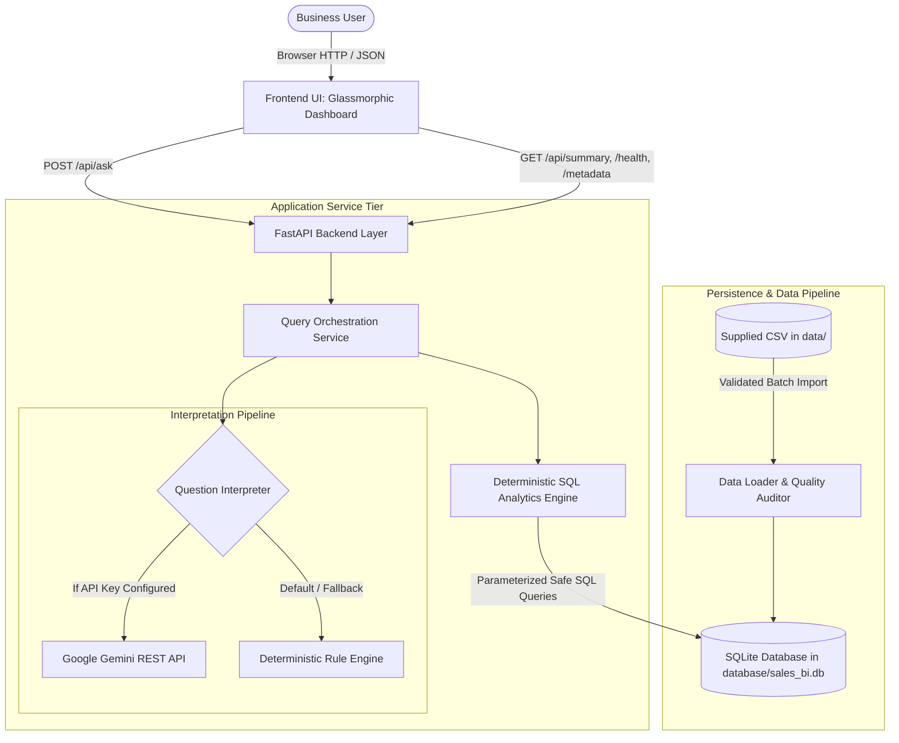
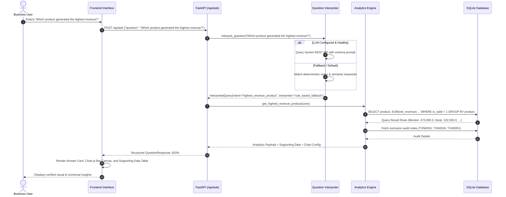

# System Architecture Documentation

This document describes the architectural design, data pipelines, schema design, security mechanisms, and execution flow of the **Mini AI Business Intelligence Assistant**.

---

## 1. High-Level Architecture Overview

The system is designed with a clear separation of concerns, decoupling the presentation layer, API interface, natural-language interpretation, analytical engine, and persistence store.

---

## 2. Component Breakdown

### 2.1. Presentation Layer (`frontend/`)
- Built using **HTML5**, **Vanilla CSS3**, and **Vanilla JavaScript (ES6+)**.
- Zero client-side framework bloat (no React, Next.js, or Tailwind compilation required).
- Includes **Chart.js** via CDN to dynamically visualize metrics (bar, line, and dual-axis charts).
- Modern dark glassmorphic styling utilizing CSS custom properties, backdrop blur filters, and accessible contrast ratios.
- Automatically queries `/api/health` and `/api/summary` on page load to establish live connectivity and populate executive KPI summary cards.

### 2.2. API Service Layer (`app/main.py`)
- Built on **FastAPI** running atop **Uvicorn** ASGI server.
- Handles HTTP routing, CORS headers, JSON request/response validation via Pydantic, and static asset serving.
- Startup lifespan hook verifies database initialization and triggers CSV loading if records are absent.
- Centralized exception handlers ensure internal stack traces and server internals are never leaked to client responses.

### 2.3. Query Orchestration Service (`app/services.py`)
- Coordinates the workflow between question interpretation and analytical execution.
- Bridges the interpreted intent (e.g., `total_revenue`, `highest_revenue_product`) to the corresponding SQL analytical routines.
- Formats authoritative natural-language answers, constructs tabular supporting datasets, builds Chart.js configuration payloads, and appends data-quality disclosure notes.

### 2.4. Question Interpreter (`app/question_interpreter.py`)
- Employs a dual-tier strategy:
  1. **Tier 1 (Genuine LLM):** If `GEMINI_API_KEY` is present in the environment, sends the user query to the Gemini REST endpoint with a strict classification prompt. The LLM returns a structured JSON payload containing the intent and extracted parameters (e.g. `month1`, `month2`).
  2. **Tier 2 (Deterministic Rule-Based Fallback):** When no API key is provided or if network calls fail, a regex and keyword-based classifier resolves the five supported business questions deterministically.
- Clearly states `interpreter_used` in the API response (`"rule_based_fallback"` or `"gemini_llm"`).

### 2.5. Deterministic SQL Analytics Engine (`app/analytics.py`)
- Executes parameterized SQL aggregation queries against SQLite.
- Operates strictly on valid records (`is_valid = 1`).
- Implements safe mathematical routines, including zero-baseline handling when calculating percentage changes.
- Gathers data-quality disclosures from flagged records to ensure full transparency.

### 2.6. Data Loader & Quality Pipeline (`app/data_loader.py`)
- Inspects `data/` dynamically to locate the supplied CSV file.
- Computes SHA256 file hashes to guarantee import idempotency (preventing duplicate rows across server restarts).
- Evaluates individual records against strict business data-quality rules, assigning audit flags and human-readable exclusion reasons.

---

## 3. Database Schema Design

The SQLite database (`database/sales_bi.db`) consists of two primary tables:

### 3.1. `sales_transactions`
Stores both eligible sales records and flagged questionable transactions.

| Column | Type | Constraints | Description |
|---|---|---|---|
| `transaction_id` | TEXT | PRIMARY KEY | Unique business transaction identifier (e.g. `TXN0001`). |
| `order_date_raw` | TEXT | NOT NULL | Raw date string as provided in the CSV (`DD-MM-YYYY`). |
| `order_date_iso` | TEXT | Indexed | Standardized ISO date (`YYYY-MM-DD`) for chronological sorting. |
| `order_year` | INTEGER | - | Extracted order year (e.g. `2026`). |
| `order_month` | INTEGER | - | Extracted order month number (`1` to `12`). |
| `year_month` | TEXT | Indexed | Composite monthly period (`YYYY-MM`, e.g. `2026-01`). |
| `product` | TEXT | Indexed | Product name (e.g. `Monitor`, `Desk`). |
| `category` | TEXT | - | Product category (e.g. `Accessories`, `Furniture`). |
| `region` | TEXT | Indexed | Geographical sales region (`North`, `South`, `East`, `West`). |
| `sales_channel` | TEXT | - | Sales channel (`Online`, `Retail`). |
| `quantity` | INTEGER | - | Number of units in transaction. |
| `unit_price` | REAL | - | Price per unit in currency units. |
| `discount_amount`| REAL | DEFAULT 0.0 | Transaction-level discount applied. |
| `status` | TEXT | Indexed | Order fulfillment status (`Completed`, `Returned`). |
| `gross_revenue` | REAL | - | Computed as $\text{Quantity} \times \text{Unit Price}$. |
| `net_revenue` | REAL | - | Computed as $\text{Gross Revenue} - \text{Discount Amount}$. |
| `is_valid` | INTEGER | Indexed, DEFAULT 1 | Boolean flag (`1` for eligible sales, `0` for excluded records). |
| `data_quality_flag`| TEXT | - | Machine-readable flag (`VALID`, `RETURNED_TRANSACTION`, `ZERO_QUANTITY`, etc.). |
| `exclusion_reason` | TEXT | - | Human-readable explanation of why the record was excluded. |
| `imported_at` | TIMESTAMP | DEFAULT CURRENT_TIMESTAMP | Timestamp of CSV ingestion. |

### 3.2. `import_history`
Maintains an audit log of CSV imports to prevent duplicate ingestion.

| Column | Type | Constraints | Description |
|---|---|---|---|
| `id` | INTEGER | PRIMARY KEY AUTOINCREMENT | Import sequence ID. |
| `filename` | TEXT | NOT NULL | Name of the source CSV file. |
| `file_hash` | TEXT | NOT NULL | SHA256 checksum of the CSV file. |
| `total_records` | INTEGER | NOT NULL | Total rows ingested from the file. |
| `valid_records` | INTEGER | NOT NULL | Count of valid completed transactions. |
| `flagged_records`| INTEGER | NOT NULL | Count of records flagged and excluded. |
| `imported_at` | TIMESTAMP | DEFAULT CURRENT_TIMESTAMP | Import timestamp. |

---

## 4. End-to-End Data Flow

---

## 5. Security & Reliability Architecture

1. **Parameter Safe SQL:** All SQL operations use parameterized queries (`?` or `:name`). User-supplied input is never concatenated directly into SQL query strings, eliminating SQL injection risks.
2. **Read-Only Analytics:** The analytics engine executes strictly read-only `SELECT` statements. DDL or destructive DML commands (`DROP`, `DELETE`, `UPDATE`, `ALTER`) are prohibited.
3. **No Direct LLM-to-Database Execution:** The LLM does not generate SQL statements directly. It only identifies the high-level intent and parameters, which are validated against strict Pydantic schemas before predefined analytical functions are executed.
4. **Secret Protection:** Secrets (such as `GEMINI_API_KEY`) are managed exclusively through environment variables and `.env` files. Keys are never logged, echoed in API responses, or committed to version control.
5. **Idempotency & Concurrency:** The database engine operates in SQLite Write-Ahead Logging (WAL) mode to permit concurrent reads without table lock contention.
